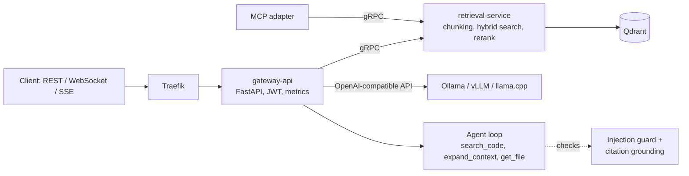

# CodeSage

[](https://github.com/athish-shubhan/CodeSage/actions/workflows/ci.yml)

A local-LLM coding assistant: index a repository, ask a question, get a streamed answer with `[file:start-end]` citations that are checked against what was actually retrieved. Retrieval is hybrid (dense vectors + BM25, optional cross-encoder rerank), the LLM runs locally behind an OpenAI-compatible API (Ollama, vLLM or llama.cpp), and nothing leaves your machine.

Why it exists: code Q&A tools tend to cite lines they never saw and will follow instructions planted in the repo they read. CodeSage treats retrieved text as untrusted, verifies every citation, and ships an eval gate in CI so those checks cannot silently regress.

## Quick start (8 GB Apple Silicon Mac, no Docker)

Prerequisites: Python 3.10+ and [Ollama](https://ollama.com).

```bash
git clone https://github.com/athish-shubhan/CodeSage && cd CodeSage
make demo
```

`make demo` creates `.venv`, starts the retrieval service (in-memory Qdrant) and the gateway, pulls `llama3.2:3b` (about 2 GB, 4-bit; override with `DEMO_MODEL=...`), ingests the 4-file `eval/fixture/repo`, asks "Does refund_payment require approval for large refunds?", and streams the answer over WebSocket with its citation check. The first run also downloads the 90 MB embedding model. The fixture contains a planted "ignore previous instructions" comment, so the output also shows the injection guard removing it.

If you prefer a hosted free tier over a local model, point `GATEWAY_LLM_BASE_URL`, `GATEWAY_LLM_MODEL` and `GATEWAY_LLM_API_KEY` at any OpenAI-compatible endpoint. The client speaks only that protocol; no hosted provider has been tested.

Full stack (Traefik, Prometheus, Grafana, Qdrant server) with Docker: `cp .env.example .env && make up && make pull-model && make ingest-self && make smoke`. Set `LLM_MODEL=llama3.2:3b` in `.env` on small machines; the default is an 8B model.

## Architecture



- Retrieval: AST-aware chunking, dense search by default, optional BM25 fusion and cross-encoder rerank (both off by default because they did not pay off on the measured corpus, see Results). Ingestion is incremental and idempotent.
- Endpoints: `POST /chat`, `WS /ws/chat` (token streaming), `POST /agent` (bounded tool-calling loop), `POST /agent/stream` (the same run as server-sent events).
- Reliability: instruction-like sentences in retrieved text are removed and reported, citations are marked grounded or ungrounded, an opt-in repair turn lets the model fix bad citations, an audit log records agent runs, and one `X-Request-ID` follows a request through both services.
- Hardening: non-root, read-only containers, request size limits, ingest restricted to allow-listed roots, internal addresses kept out of error responses.
- Details: [docs/architecture.md](docs/architecture.md) and the [design records](docs/adr/); history of the nine improvement rounds in [IMPROVEMENTS.md](IMPROVEMENTS.md).

## Results

All numbers are from commands in [docs/results/README.md](docs/results/README.md) or from [docs/evaluation.md](docs/evaluation.md).

| What | Result | Source |
|---|---|---|
| Retrieval, 22 questions on this repo (real embeddings, 2 CPUs) | Dense Recall@5 0.70 / MRR 0.51; hybrid 0.70 / 0.45; hybrid + rerank 0.80 / 0.49 at about 25x latency | `docs/evaluation.md` (`make eval`) |
| Re-ingest of an unchanged repo (129 files, 637 chunks) | 0 chunks re-embedded; one edited file re-embeds 3 | `make bench-ingest` |
| Shared vs per-call gRPC channel (1000 loopback calls) | p50 0.72 ms to 0.27 ms | `make bench-grpc` |
| Injection guard, 43 labeled sentences | catches 18 of 23 injections, flags 2 of 20 benign; 1 flag in 47 ordinary files | `make eval-agent` |
| Tests | gateway 137, retrieval 69, integration 6, eval 32 passing; ruff clean | `docs/results/README.md` |

The default is dense-only retrieval because that is what the measurements support; the ablation is kept so a different corpus can overturn it.

## Tests and evaluation

```bash
make test test-retrieval test-eval test-integration   # unit + gRPC integration, no Docker, LLM mocked
make lint                                              # ruff
make eval-agent                                        # injection / citation / abstention gate, no LLM
make eval                                              # retrieval ablation (needs the stack and `make ingest-self`)
```

CI (GitHub Actions) runs lint, all test suites, the agent reliability gate (blocking), a retrieval-quality gate on a fixture corpus (blocking), the MCP adapter tests, image builds with non-root and read-only checks, and compose/k8s validation.

## Limitations

- Demo project, not a production service: one demo user from environment variables, a placeholder JWT secret you must change, no TLS, no multi-turn memory.
- Retrieval benchmark is 22 questions on one corpus. Answer quality with a live model (grounded-citation rate, abstention) is not measured; the agent eval runs scripted model turns.
- Small local models follow the tool-calling protocol unreliably (a 0.5B model did not; 3B and larger are not measured here). `/ws/chat` and `/chat` do not need tool calling and are what the quick start uses.
- The quick start path with a real Ollama model was not run in the environment that prepared this repository; its client, gateway and retrieval path were exercised with a scripted LLM and a stand-in embedder.
- The injection regex misses paraphrased, translated and obfuscated injections ([ADR 0006](docs/adr/0006-untrusted-tool-output.md)).
- Only Ollama has been tested live for tool calling.

## Demo


*`make demo` with `llama3.2:3b` on an 8 GB M1: ingests the fixture repo, strips two planted instruction-like comments before they reach the model, and streams an answer that correctly spots the fixture's planted bug (large unapproved refunds return `True`). This small model emitted no `path:lines` citations, so both citation lists are empty; larger models cite more reliably.*

## Design decisions

Each of these is a short record of the options, what was chosen, and what it costs, in `docs/adr/`:

- [0001](docs/adr/0001-grpc-between-gateway-and-retrieval.md) gRPC between the gateway and retrieval, with a shared channel and retries only on `UNAVAILABLE`
- [0002](docs/adr/0002-dense-retrieval-by-default.md) Dense retrieval by default, because hybrid fusion measured no better on this corpus
- [0003](docs/adr/0003-native-agent-loop.md) A bounded native agent loop instead of an agent framework
- [0004](docs/adr/0004-idempotent-incremental-ingestion.md) Idempotent, incremental ingestion with Qdrant as the only durable store
- [0005](docs/adr/0005-in-process-tracing-not-opentelemetry.md) In-process trace spans and Prometheus, not OpenTelemetry yet
- [0006](docs/adr/0006-untrusted-tool-output.md) Treat agent tool output as untrusted data

## Repository layout

```
services/
  gateway-api/          FastAPI: REST, WebSocket, agent loop, JWT auth, metrics
  retrieval-service/    gRPC: chunking, embedding, dense/hybrid search, reranking
  edge-inference/       compose override for running inference on a separate machine
eval/                   retrieval evaluation harness and benchmark questions
gateway/traefik/        reverse proxy config
monitoring/             Prometheus scrape config and Grafana dashboard
k8s/                    Kubernetes manifests
deploy/aws, gcp, azure/ single-VM cloud deployment scripts
docs/                   architecture, evaluation, and design decision records (adr/)
scripts/                ingestion, quantization, smoke-test, and benchmark helpers
```

## License

[MIT](LICENSE)
